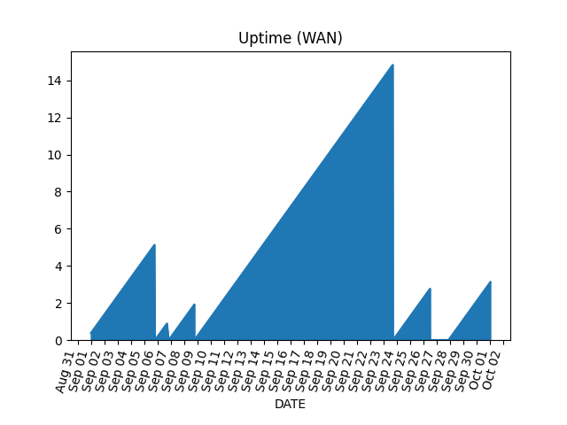

## Uptime monitor



## Usage

`./uptime.sh`

Every 60 seconds:

* Check IP address (https://www.ipify.org/ supports its use without limit)
* Log uptime to file
* If no IP address, reset uptime to zero

## Plugins

In Apache fashion, optional plugins are found in `scripts-available`.

Make a symlink from the `scripts-enabled` directory to enable.

### `uptime` plugins

These plugins are passed with an argument denoting the number of continuous minutes the service has been up.

**Echo:** prints simple output (dots or x's) to the screen.

```
cd scripts-enabled
ln -s scripts-available/uptime_echo.sh scripts-enabled/uptime_echo.sh
```

**Tally:** enable logging in order to generate uptime graphs.

```
cd scripts-enabled
ln -s scripts-available/uptime_tally.sh scripts-enabled/uptime_tally.sh
```

Graphs are generated using Python:

```
pip install matplotlib pandas
```

Add a CSV header row to the top of the CSV file:

```
DATE,DAYS
2026-10-01 00:00:50,4511
2026-10-01 00:01:50,4512
2026-10-01 00:02:50,4513
```

Pass the formatted CSV file to the report script:

```
./report.py 2026-10-report.csv
```

### `ipchange` plugins

These plugins are called when the IP address changes, passing the new IP address as a parameter.

**Cloudflare:** updates DNS records automatically.

`cp .env.example .env` and replace values with your API keys and domain info.

```
cd scripts-enabled
ln -s scripts-available/ipchange_cloudflare.sh \
  scripts-enabled/ipchange_cloudflare.sh
```

Additional plugins may be created for other DNS providers

## Future metrics

* Total number of outages
* Duration of outages (uptime %)
* Longest continuous block
* Average time between outages
